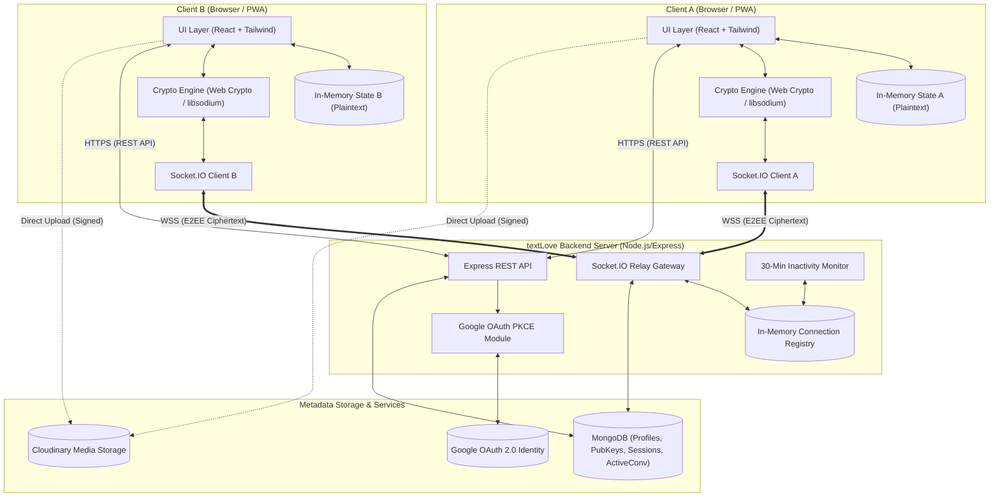
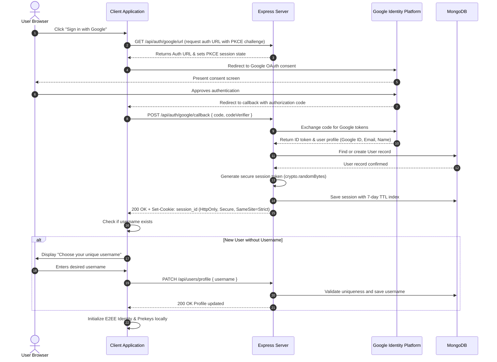
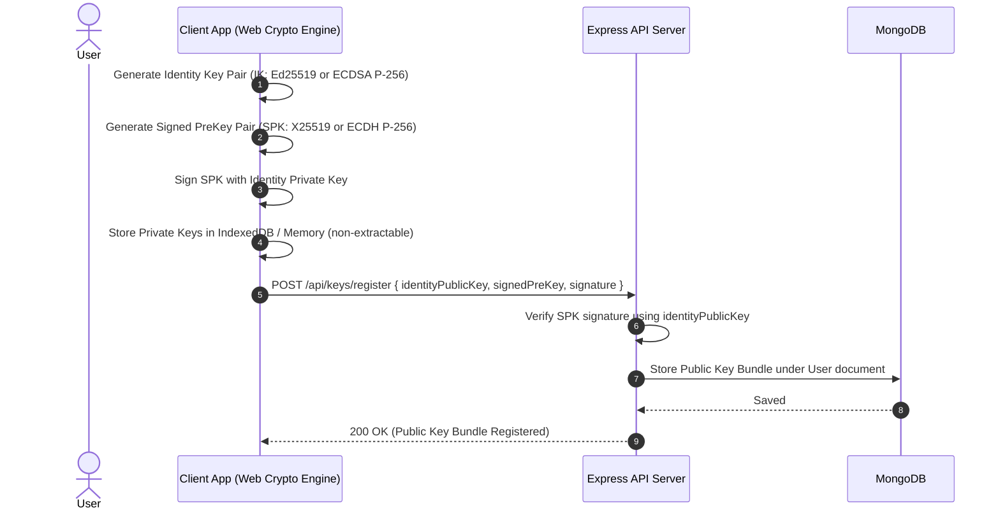
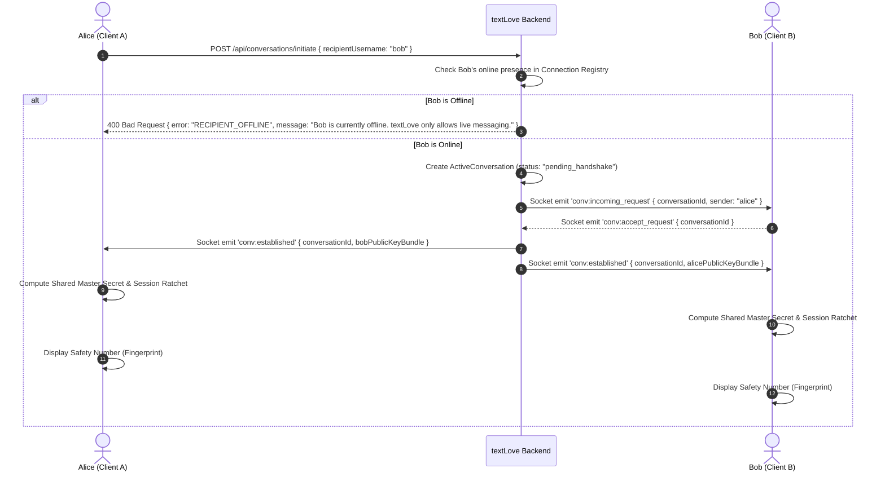
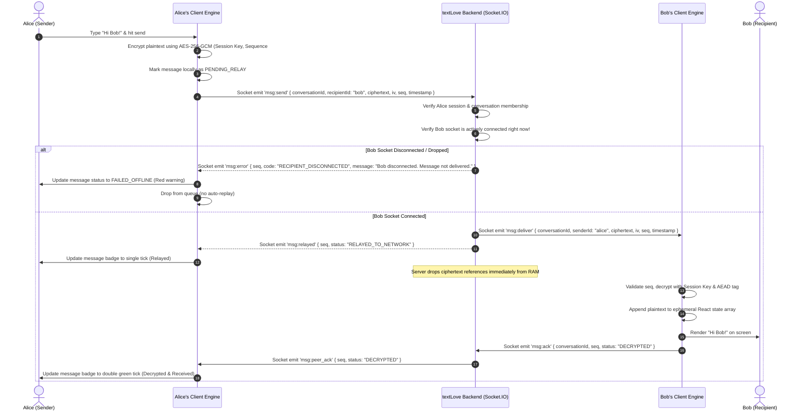
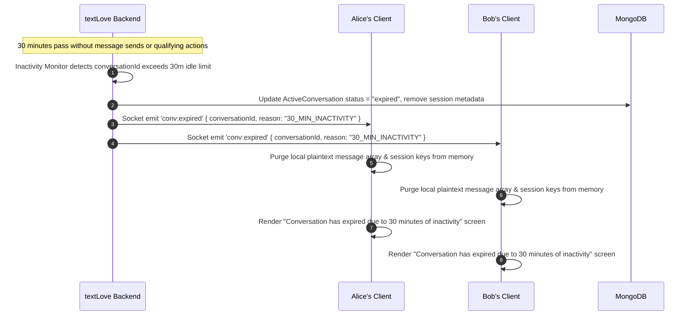

# textLove - Data Flow & Component Diagrams

This document illustrates the operational flows, architectural boundaries, and sequence diagrams of textLove.

---

## 1. System Component Diagram

---

## 2. Authentication & Onboarding Sequence Flow

---

## 3. Client Key Generation & Public Key Bundle Registration

---

## 4. Conversation Initialization & Live Handshake Sequence

---

## 5. Live-Only Message Send & Ephemeral Relay Sequence

---

## 6. Conversation Expiry & Teardown Sequence

